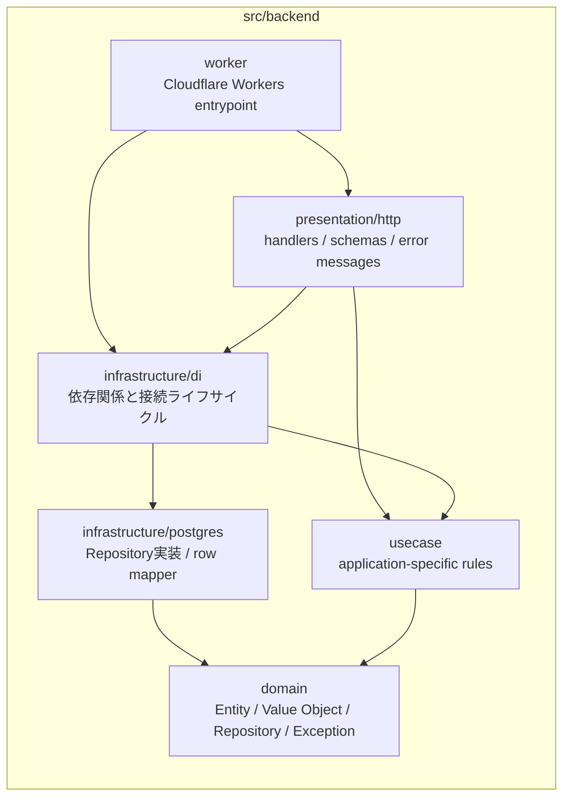
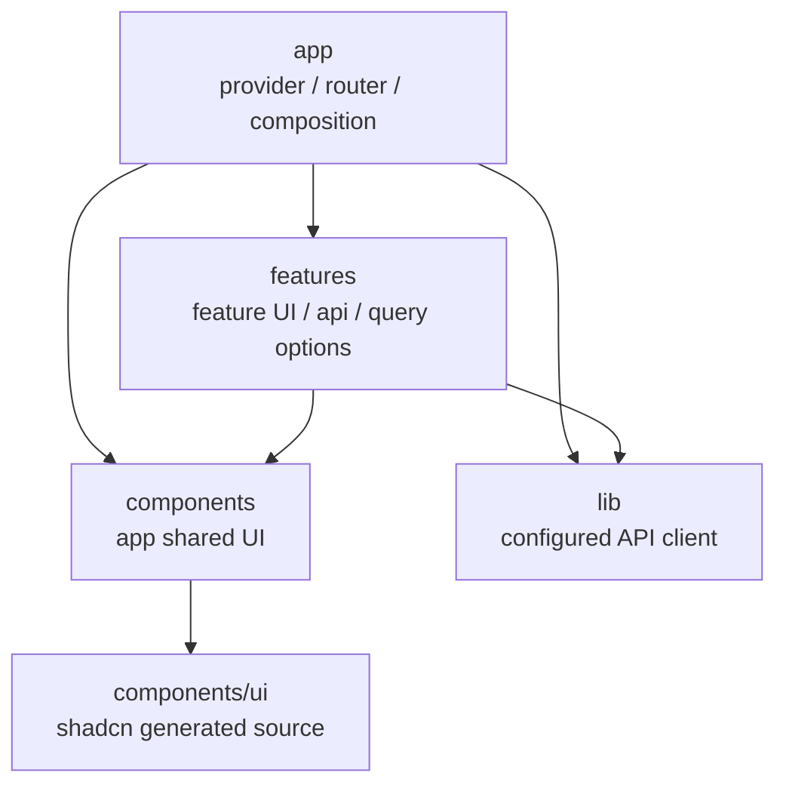

# 家計簿アプリ 技術構成

更新日: 2026-10-11

機能と運用上の要件は [MVP要件](./mvp-spec.md)、バックエンドの構造と各層の責務は [バックエンド設計](./backend-architecture.md) にまとめる。

## バックエンドの依存関係

矢印は実行時の呼び出し順ではなく、ソースコードの依存方向を表す。依存は外側から内側だけへ向け、`domain`は他の層や外部サービスへ依存しない。

- `worker`はCloudflare WorkersのランタイムをHonoとInfrastructureへ接続する。
- `presentation`はHTTPとDomain／UseCaseの表現を相互変換し、業務ルールを直接実装しない。
- `infrastructure/di`はRepository実装、UseCase、接続とトランザクションのライフサイクルを組み立てる。
- `infrastructure/postgres`はDomain Repositoryを実装し、PostgreSQLの詳細を内側へ漏らさない。
- `usecase`は一つのpublic `execute`を持つUseCase interfaceと具象classで処理を調整し、`domain`のEntity、Value Object、Repositoryを利用する。
- `domain`は最も内側に置き、Hono、Clerk、PostgreSQL、Cloudflare Workersへ依存しない。
- 月次集計と月初日のValue Objectは`domain/monthly`に置き、月次取得UseCaseは`usecase/monthly`、SQL Repositoryは`infrastructure/postgres/monthly`に置く。

## フロントエンドの依存関係

[Bulletproof React](https://github.com/alan2207/bulletproof-react)のfeature-based構成と単方向の依存を参考にする。ただし、サンプルのライブラリや抽象化をそのまま導入せず、このアプリで必要になった境界だけを採用する。

- `app`は認証、QueryClient、Router、featureを組み立てる。featureや共通部品から`app`へ依存しない。
- 機能固有のfetcher、リクエスト・レスポンス型、TanStack Queryの`queryOptions`は`features/<feature>/api`へ同居させる。URLやHTTP methodを画面コンポーネントへ書かない。
- `lib/api-client.ts`は認証トークン付与、HTTP送信、レスポンス解析、通信不能時の安全な正規化だけを担当する。feature固有のエンドポイント、Query key、画面通知を持たせない。
- 認証済みセッションごとに設定済みAPIクライアントを一つ生成し、各featureのfetcherへ注入する。
- feature間を直接importしない。複数featureで必要になったものだけを`components`または`lib`へ移す。
- `components/ui`とshadcnが追加した補助ファイルは生成元として直接編集しない。アプリ固有の見た目と操作要件は`components`または`features`のラッパーで追加する。
- 各featureに`api`、`components`、`hooks`などを一律に作らない。必要になったディレクトリだけを追加する。

## 決定済み

- 画面はReact＋Viteを使用し、TypeScriptで実装する。
- 画面遷移はTanStack Routerのfile-based routing、サーバー状態はTanStack Queryで管理する。画面コンポーネントへURL、HTTP method、Query keyを分散させない。
- フロントエンドの日本語・英語・スペイン語文言はParaglide JSを通し、翻訳を`src/react-app/i18n/locales/`、アプリ向けの窓口を`src/react-app/i18n/messages.ts`へ置く。言語選択はParaglideのlocalStorage戦略で端末に保存する。
- スタイリングはTailwind CSS v4を基本とし、shadcn/uiは必要なコンポーネントのソースコードを追加する手段として使う。shadcnが生成したファイルは直接変更せず、アプリ固有の見た目と操作要件はラッパーまたはfeature側で追加する。
- API通信はsame-originのnative fetchを薄く設定した`lib/api-client.ts`を使う。Axiosなどの別HTTPクライアントは追加せず、必要なHTTP methodだけを公開する。
- APIはCloudflare Workersで実装し、画面と同じオリジンの`/api`として公開する。
- Cloudflare WorkersのバックエンドもTypeScriptで実装する。フロントエンドと開発言語・型・検証処理を共有し、Clerkと`pg`を利用する。
- WorkerのHTTPフレームワークにはHonoを使い、`/api`のルーティング、認証ミドルウェア、入力検証、HTTPレスポンス変換、共通エラー処理を担当させる。
- バックエンドはdddpyを基準とするオニオンアーキテクチャとし、Entity、Value Object、Domain Repository、Domain Exception、UseCase、Repository実装、DB row mapper、DI、Presentationを分離する。
- `src/backend/domain`には機能ごとのDomain modelとRepository interface、`src/backend/usecase`には一ユースケース一UseCase、`src/backend/infrastructure/postgres`には生SQLを使うRepository実装とDB行のmapper、`src/backend/infrastructure/di`には依存関係と接続ライフサイクル、`src/backend/presentation/http`にはHono handlerとschema、`src/backend/worker/index.ts`にはWorkers entrypointを置く。
- Repositoryはテーブル単位ではなくEntityまたは集約単位で定義する。UseCase実装はconstructor injectionでRepositoryを受け取り、Infrastructureのfactoryが具象実装を接続する。
- MVPはログイン後の利用を中心とし、検索エンジン向けの公開ページは作らない前提とする。
- Googleログインとセッション管理にはClerkを使う。MVP後も認証方法はGoogleだけとし、メール、パスワード、電話番号などの認証方式は追加しない。
- 家計簿データの保存先にはNeonのPostgreSQLを使う。
- DBアクセスにはORMを使わず、パラメータ化した生SQLをサーバー側で実行する。Drizzleは導入しない。
- WorkerからNeonへのDBアクセスはCloudflare Hyperdriveを経由し、`pg`の`Client`をリクエスト単位で生成・終了する。複数SQLは同じ接続上で`BEGIN`・`COMMIT`し、失敗時は`ROLLBACK`する。
- Hyperdriveのクエリキャッシュは、書き込み後の認可・家計データを常に最新状態で読むため無効にする。
- ローカル開発と結合テストにはDockerのPostgreSQL 15を使い、永続化する`budget_app_dev`と、テストごとにデータを初期化する`budget_app_test`を分ける。WorkerのローカルHyperdrive接続だけを開発DBへ向ける。
- DBスキーマの変更は、dbmateで管理するSQLマイグレーションファイルとして記録する。開発時・デプロイ時に適用し、Workerのリクエスト処理中には実行しない。
- Clerkの認証だけで家計データのアクセス制御が完結するとは扱わない。すべての読み書きで、サーバー側がログイン利用者の対象データへの権限を確認する。
- MVPの認可はWorker側で行い、PostgreSQLのRow Level Securityは使用しない。家計への所属条件をDBアクセス処理に集め、別の家計への読み取り・作成・更新・削除を拒否するテストを行う。共有機能を実装する際にRLSの併用を再評価する。
- 一人用のMVPでも家計と利用者の所属関係を別に保存する。新規利用者には個人用の家計を作り、その家計の所有者として所属させる。
- `users`にはアプリ独自の主キー`id`と、一意な`clerk_user_id`を別々に持たせる。家計への所属などの外部キーは`users.id`を参照する。
- `users`にはClerkのメールアドレスと表示名を複製しない。MVPで本人の表示に必要なプロフィールはClerkから取得する。
- 個人用家計を作った利用者への参照は`households`に置き、利用者ごとに一つだけ作れるよう一意制約を設ける。`users`には家計IDを持たせない。家計へのアクセス権は`household_members`で管理する。
- MVPの`household_members`は家計IDと利用者IDの所属関係だけを保存し、役割列は設けない。個人用家計を作った人は`households`で識別する。共有時の権限差が決まった段階で役割を追加する。
- MVPの`households`には家計名を保存しない。共有家計を扱う段階で、名前と表示方法を決める。
- 費目一覧にはアプリ共通の初期費目と、その家計で作成した追加費目を表示する。初期費目は固定順、追加費目は作成順とし、名前変更で順番を変えず、MVPでは並べ替え機能と専用の順序列を設けない。
- 費目の`created_at`は表示順と管理用にだけ使い、費目の有効開始日としては扱わない。追加した費目を、その作成前の日付の支出にも使用できる。
- `categories.updated_at`を持たせ、追加費目の名前変更SQLで`updated_at = now()`を明示する。
- `users`には`updated_at`を設けない。MVPの`users`に更新対象の列はないため、将来、利用者設定などを追加した時点で再検討する。
- `users.clerk_user_id`は利用者作成時に保存し、その後は変更しない。Googleアカウントのメールアドレス変更では付け替えず、別のClerk利用者IDへの移行やアカウント統合はMVPで扱わない。
- `users.created_at`はDBの`now()`で記録する。利用開始時期や初期化処理の調査に使い、MVPの画面には表示しない。
- `households.created_at`はDBの`now()`で記録する。将来、利用者登録とは別の時点で作られる共有家計も扱えるよう、家計自体の作成時刻として保持する。MVPの画面には表示しない。
- `households`には`updated_at`を設けない。MVPには家計名や設定などの更新対象がないため、変更可能な列を追加する時点で再検討する。
- `categories.household_id`は、アプリ共通の初期費目では`NULL`、利用者が追加した費目では所属する家計IDとする。初期費目は家計ごとに複製しない。
- `categories.seed_key`は初期費目だけに設定し、`food`、`daily_goods`、`housing`、`utilities`、`communications`、`transportation`、`medical`、`entertainment`、`other`の9種類だけをDBの`CHECK`制約で許可する。利用者が追加した費目では`NULL`とする。
- 初期カテゴリーはDBマイグレーションで一度だけ登録する。`seed_key`と名前の変更・行の削除はDBトリガーでも拒否し、費目の更新APIでは`seed_key`を入力として受け取らない。
- 費目名はAPIで前後の空白を除去し、DBでも先頭・末尾が空白文字ではないことを`CHECK`制約で保証する。文字数制約と合わせ、アプリ以外のSQLから不整合な名前が保存されることも防ぐ。
- 支出のカテゴリーは任意とし、`expenses.category_id`の`NULL`を「未分類」として扱う。未分類の支出も月全体の集計に含め、カテゴリー絞り込みでは`NULL`を未分類として指定できるようにする。
- `users`・`households`・`categories`・`expenses`の主キーはPostgreSQLの`uuid`型とし、DBで`gen_random_uuid()`により生成する。`household_members`は家計IDと利用者IDの複合主キーとする。
- 支出額は1円単位の`integer`型で保存し、正の値に制約する。`SUM(integer)`の結果は`bigint`なので、APIで安全に数値として扱える範囲を確認する。
- PostgreSQLから受け取る`bigint`の集計値は、APIでJavaScriptの安全な整数範囲内か確認してから`number`へ変換する。範囲を超えた場合は成功レスポンスを返さず、集計エラーとして扱う。
- 支出額は1〜2,147,483,647円を画面・API・DBで検証する。
- 支出日は時刻を持たない`date`型で保存する。
- MVPの「今日」と「今月」は`Asia/Tokyo`で判定する。支出の未来日付チェックと最初に表示する月に同じ基準を使う。利用者が入力した支出日は日付そのものとして保存し、タイムゾーン変換しない。
- 支出日にアプリ独自の下限は設けない。APIで厳密な`YYYY-MM-DD`形式と実在する日付を検証し、`Asia/Tokyo`の今日以前だけを許可する。
- 支出・追加カテゴリーなどの家計データは家計IDに紐づける。初期費目だけはアプリ全体で共有する。MVPでは一つの家計に一人だけ所属し、共有操作は提供しない。
- 個人用家計は、Clerkで認証した利用者が`POST /api/bootstrap`を呼んだときに作成する。利用者・家計・所属は、同時リクエストでも重複や作成途中の状態が残らないよう、DBの一意制約と一つのトランザクションで初期化する。作成用の`user.created` Webhookには依存しない。
- 初期費目9件はbootstrapの責務に含めない。アプリ環境を構築する初期マイグレーションで共通データとして一度だけ登録し、家計作成時には追加しない。bootstrapは件数確認・修復・再投入を行わない。
- 個人用家計の作成者は、家計の作成と同じDBトランザクションで`household_members`にも追加する。作成者の所属を保証する循環外部キーは設けず、この初期化処理とテストで整合性を確認する。
- 追加カテゴリーは名前変更・削除できる。削除時は、そのカテゴリーを参照する支出の`category_id`だけを`NULL`にして未分類へ戻し、支出自体は残す。
- 家計を削除したときは、その家計の所属・追加カテゴリー・支出を外部キーの`ON DELETE CASCADE`で削除する。アプリ共通の初期費目は残す。
- 支出の作成・更新で指定する費目は、アプリ共通の初期費目または同じ家計の追加費目であることをAPIとDBで確認する。
- 支出の作成・更新では費目を指定しないことも許可する。設定済みの費目を外す更新では`category_id`を`NULL`にして未分類へ戻す。
- 支出の削除は`expenses`の行を物理削除する。画面では削除前に確認を求め、集計とCSVは残存する支出行のみを対象にする。
- 支出の編集は`expenses`の該当行を更新し、変更前の金額・日付・費目・メモを保存する履歴テーブルはMVPでは設けない。
- MVPの取引データは支出専用の`expenses`に保存する。収入・返金・口座間の移動を含む共通の取引テーブルは、各機能の要件が決まったときに検討する。
- MVPの`expenses`には入力者IDを保存しない。各家計に一人しか所属しないため、共有機能を実装するときに列を追加できる。既存行の入力者が必要になれば個人用家計の作成者から補完する。
- 同じ日・金額・費目の支出を複数登録できるようにし、これらの列を組み合わせた一意制約は設けない。
- 支出一覧は`expense_date DESC, created_at DESC, id DESC`で並べる。編集では`created_at`を変えないため、同じ日付内で編集した支出が先頭へ移動しない。
- MVPの支出一覧APIは、選択した1か月分をページ分割せずに返す。実際の利用件数が増えた場合にカーソル方式を追加する。
- 費目による支出一覧の絞り込みは、取得済みの1か月分をブラウザ側で処理する。費目を切り替えるたびにAPIへ再問い合わせしない。
- `expenses.updated_at`はMVPから保持し、支出が最後に変更された時刻を記録する。支出一覧の並び順には使わない。
- 支出を更新するSQLでは、変更する列とともに`updated_at = now()`を明示する。MVPでは更新時刻を変更するDBトリガーを設けない。
- 支出メモはAPIで前後の空白を取り除き、空文字になった場合は`NULL`として保存する。500文字を上限とし、画面とAPIで検証する。DBでも`char_length(memo) <= 500`の制約を設ける。

## MVPのDB設計

| テーブル | 主な内容 |
| --- | --- |
| `users` | アプリ独自の利用者IDと一意なClerk利用者ID。Clerkのメールアドレスと表示名は複製しない。 |
| `households` | 家計ID、個人用家計を作った利用者ID。利用者ごとに一つだけ作る。 |
| `household_members` | 家計IDとアプリ独自の利用者ID。MVPでは個人用家計を作った人だけが所属する。 |
| `categories` | 任意の家計ID、名前、初期費目の識別子。家計IDが`NULL`ならアプリ共通の初期費目、家計IDがあればその家計の追加費目。 |
| `expenses` | 家計ID、任意の費目ID、支出日（`date`）、1円単位の金額（`integer`）、任意のメモ。費目IDが`NULL`なら未分類。MVPでは入力者IDを保存しない。 |

- 所属は家計IDとアプリ独自の利用者IDの組を一意にし、個人用家計も利用者ごとに一つだけ作れるようにする。
- ログイン利用者から所属家計を取得する検索と将来の家計共有に備え、`household_members(user_id)`のインデックスを設ける。複合主キーは`household_id`から始まるため、`user_id`だけの検索にはこの別インデックスを使う。
- 支出の未来日付禁止はAPIでも確認する。
- 支出一覧と月次集計のため、`expenses(household_id, expense_date DESC, created_at DESC, id DESC)`のインデックスを設ける。
- 費目による支出一覧の絞り込みは取得済みの月次データに対してブラウザ側で行うため、`expenses.category_id`用の追加インデックスはMVPでは設けない。
- 初期費目の識別子を名前と分け、初期マイグレーションで9件だけ登録する。家計作成処理から初期費目を分離する。
- 費目一覧は件数が少ないため、表示順専用の追加インデックスはMVPでは設けない。
- 費目名は、アプリ共通の初期費目と各家計の追加費目を通じて一意にする。別々の家計がそれぞれ同じ追加費目名を使うことは許す。
- 英字の大文字・小文字だけが異なる費目名は同名として扱う。追加費目同士は`(household_id, lower(name))`の一意インデックス、初期費目との衝突はDBトリガーとAPIで拒否する。
- 費目名はAPIで前後の空白を取り除いてから保存し、1〜50文字を画面・API・DBで検証する。空白だけの名前を拒否し、整えた保存後の名前を家計内の同名判定に使う。
- 口座、カード、定期支出の自動登録に使うテーブルはMVPの対象外とする。
- MVP後のサブスク管理には `subscriptions` テーブルを追加し、契約中の固定額、周期、次回支払基準日、休日調整を保持する。祝日の判定には `@holiday-jp/holiday_jp` を使い、銀行休業日のうち土日と12月31日〜1月3日はアプリ側で判定する。
- 支払日の自動登録は Workers の Scheduled Handler を UTC 15:10（日本時間 00:10）に起動し、処理対象日を日本時間で決める。`subscription_occurrences` の `(subscription_id, schedule_version, occurrence_index)` 主キーで発生回を一意にし、支出を削除しても発生回を残す。サブスクごとの行ロックとトランザクションで、支出作成・発生回記録・次回日の更新を同時に確定する。

### `users`の列

| 列 | 型・制約 | 用途 |
| --- | --- | --- |
| `id` | `uuid PRIMARY KEY DEFAULT gen_random_uuid()` | アプリ内の利用者ID。 |
| `clerk_user_id` | `text NOT NULL UNIQUE` | Clerkから受け取る、作成後に変更しない利用者ID。 |
| `created_at` | `timestamptz NOT NULL DEFAULT now()` | アプリ内の利用開始時刻。画面には表示しない。 |

メールアドレスと表示名は`users`に保存しない。`clerk_user_id`を変更する更新APIも設けない。

### `households`の列

| 列 | 型・制約 | 用途 |
| --- | --- | --- |
| `id` | `uuid PRIMARY KEY DEFAULT gen_random_uuid()` | 家計ID。 |
| `personal_owner_user_id` | `uuid NOT NULL UNIQUE REFERENCES users(id) ON DELETE NO ACTION` | 個人用家計を作った利用者。一人につき一つを保証し、利用者だけの削除を防ぐ。 |
| `created_at` | `timestamptz NOT NULL DEFAULT now()` | 家計の作成時刻。画面には表示しない。 |

MVPでは家計名と`updated_at`を保存しない。

### `household_members`の列

| 列 | 型・制約 | 用途 |
| --- | --- | --- |
| `household_id` | `uuid NOT NULL REFERENCES households(id) ON DELETE CASCADE` | 所属先の家計。 |
| `user_id` | `uuid NOT NULL REFERENCES users(id)` | 所属する利用者。 |

主キーは`(household_id, user_id)`。利用者から所属家計を引くため、`user_id`に別のインデックスを設ける。`user_id`側の外部キーは連鎖削除にせず、退会時は家計を先に削除する。
個人用家計の作成者の所属行は、家計と同じトランザクションで作成する。循環外部キーは設けない。

### `categories`の列

| 列 | 型・制約 | 用途 |
| --- | --- | --- |
| `id` | `uuid PRIMARY KEY DEFAULT gen_random_uuid()` | 費目ID。 |
| `household_id` | `uuid NULL REFERENCES households(id) ON DELETE CASCADE` | 初期費目では`NULL`。追加費目では所属する家計。 |
| `name` | `text NOT NULL CHECK (char_length(name) BETWEEN 1 AND 50 AND name !~ '^[[:space:]]' AND name !~ '[[:space:]]$')` | 前後の空白を除いた表示名。家計内で一意。 |
| `icon_name` | `text NOT NULL DEFAULT 'tag'`、小文字英数字とハイフン、1〜64文字 | Lucideのアイコン名。APIで導入済みアイコン一覧と照合する。 |
| `seed_key` | `text NULL CHECK (seed_key IN ('food', 'daily_goods', 'housing', 'utilities', 'communications', 'transportation', 'medical', 'entertainment', 'other'))` | 初期費目の固定識別子。追加費目では`NULL`。 |
| `created_at` | `timestamptz NOT NULL DEFAULT now()` | 追加された時刻。 |
| `updated_at` | `timestamptz NOT NULL DEFAULT now()` | 追加費目の名前を最後に変更した時刻。更新SQLで`now()`へ変更する。 |

`household_id IS NULL`と`seed_key IS NOT NULL`の組を初期費目、`household_id IS NOT NULL`と`seed_key IS NULL`の組を追加費目としてDB制約で保証する。初期費目は`seed_key`の固定順、追加費目は`created_at`と`id`の順で表示し、専用の順序列と表示順専用インデックスは設けない。
初期費目の変更・削除はDBトリガーでも拒否する。追加費目を削除するときは、DBの外部キー動作によって支出を未分類へ戻す。

### `expenses`の列

| 列 | 型・制約 | 用途 |
| --- | --- | --- |
| `id` | `uuid PRIMARY KEY DEFAULT gen_random_uuid()` | 支出ID。 |
| `household_id` | `uuid NOT NULL REFERENCES households(id) ON DELETE CASCADE` | 所属する家計。 |
| `category_id` | `uuid NULL` | 任意の費目。アプリ共通または同じ家計の費目だけを許可し、`NULL`は未分類を表す。 |
| `expense_date` | `date NOT NULL` | 支出が発生した日。 |
| `amount` | `integer NOT NULL CHECK (amount BETWEEN 1 AND 2147483647)` | 1円単位の支出額。 |
| `memo` | `text NULL CHECK (char_length(memo) <= 500)` | 前後の空白を除いた任意のメモ。空なら`NULL`、最大500文字。 |
| `created_at` | `timestamptz NOT NULL DEFAULT now()` | 登録時刻。 |
| `updated_at` | `timestamptz NOT NULL DEFAULT now()` | 最後に編集した時刻。更新SQLで`now()`へ変更する。 |

`category_id`は`categories(id)`への外部キーとし、DBトリガーで初期費目または同じ家計の追加費目だけに制限する。`category_id`が`NULL`なら未分類として扱う。追加費目の削除時は`ON DELETE SET NULL`により未分類へ戻す。
MVPでは入力者の利用者IDを保存しない。

## MVP後の退会機能案

退会機能はMVPに含めず、実装時に要件を再確認する。現時点では、確認画面を経たアプリ内の専用操作からNeonの家計データとClerkアカウントを削除する案とする。削除処理中の再初期化を防ぐ必要がある場合は、`users.deletion_started_at`などの状態を追加する。Clerk側から削除された場合の`user.deleted` Webhookによる残存データ削除も、その時点で設計する。

## MVPのAPI契約

### 共通ルール

- APIは同一オリジンの`/api`以下に置き、すべてClerkの認証を必須とする。
- MVPではクライアントから`household_id`を受け取らない。Clerk利用者IDからアプリ利用者と所属家計をサーバー側で特定し、すべてのSQLへ家計ID条件を含める。
- 日付は`YYYY-MM-DD`、対象月は月初日の`YYYY-MM-01`、金額はJavaScriptの安全な整数範囲を確認したJSON numberで返す。
- エラーは`{ "error": { "code": "...", "message": "...", "fields": { ... } } }`を基本形とする。安定したエラーコードと選択言語に応じた安全なメッセージはバックエンドで一元管理し、フロントエンドは受け取った`message`を加工せず表示する。通信断などレスポンスを受け取れない場合だけ、フロントエンドの共通フォールバック文言を使用する。
- 存在しないデータと、別家計に属していて操作できないデータは、どちらも`404`として返して所属情報を推測できないようにする。
- 作成成功は`201`、取得・更新成功は`200`、削除成功は本文なしの`204`を基本とする。

### 初期化

| メソッド・パス | 用途 |
| --- | --- |
| `POST /api/bootstrap` | リクエスト本文を受け取らず、認証済み利用者、個人用家計、所属を冪等に初期化する。成功時は内部IDを返さず`204`とする。ログイン後とアプリ起動時に呼ぶ。 |

### 月次画面

| メソッド・パス | 用途 |
| --- | --- |
| `GET /api/months/:month` | 指定月の支出、月全体とカテゴリー別の集計を取得する。未来月は拒否する。 |

このAPIは`month`、月全体の`totals.expenses`、`uncategorized.expenses`、カテゴリー別の支出額、月内の`expenses`を返す。カテゴリーが未設定の支出は`categoryId: null`で表し、支出日・作成時刻・IDの降順で返す。

### 支出

| メソッド・パス | 用途 |
| --- | --- |
| `POST /api/expenses` | 日付・金額、任意の費目・メモで支出を作成する。 |
| `PATCH /api/expenses/:expenseId` | 支出の日付・金額・費目・メモを更新する。費目は`null`で未分類へ戻せる。 |
| `DELETE /api/expenses/:expenseId` | 確認済みの支出を物理削除する。 |

月内の支出一覧は`GET /api/months/:month`に含める。MVPでは支出一覧専用の取得APIとページ分割APIを設けない。

### 費目

| メソッド・パス | 用途 |
| --- | --- |
| `GET /api/categories` | 家計の費目一覧を取得する。 |
| `POST /api/categories` | 追加費目を作成する。`seed_key`は受け取らない。 |
| `PATCH /api/categories/:categoryId` | 追加費目の名前を変更する。初期費目は拒否する。 |
| `DELETE /api/categories/:categoryId` | 追加カテゴリーを削除する。関連する支出は未分類へ戻す。初期カテゴリーは拒否する。 |
